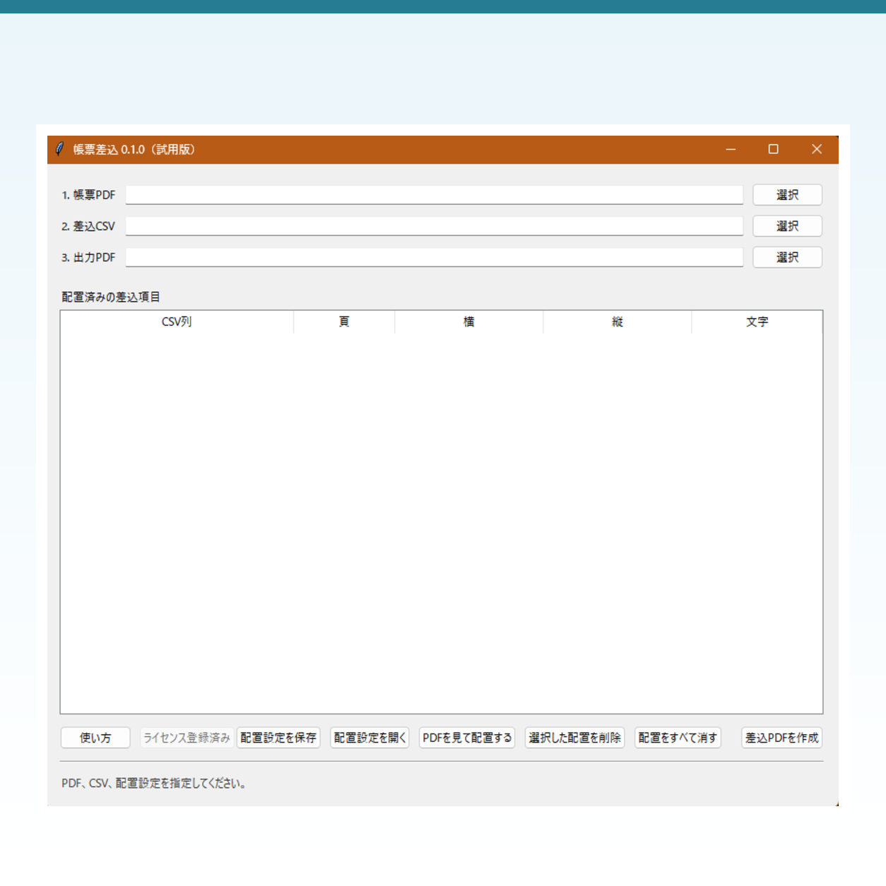

# 帳票差込 — PDF帳票へCSVを連続差込するWindowsソフト

既存のPDF帳票へCSVの各行を差し込み、個別PDFを連続作成するWindows 11向けソフトです。

- [体験版を無料ダウンロード](https://sashikomi-chohyo.booth.pm/items/9050230)
- [完全版を購入する（買い切り ¥1,480）](https://sashikomi-chohyo.booth.pm/items/9050118)
- [BOOTHショップ](https://sashikomi-chohyo.booth.pm/)

## 向いている場面

- 申込書・受講票・案内状・名札など、すでにPDFで用意されている帳票
- 氏名、受付番号、日付などをCSVから一括差し込みしたい場合
- 名簿データを外部サービスへアップロードせず、自分のPC内で処理したい場合

## できること

1. 帳票PDFとCSVを選択
2. 各CSV列をPDF上の指定位置に配置
3. CSVの各行ごとに差込済みPDFを連続作成

配置設定は保存して、同じ帳票に繰り返し使えます。

## 動作環境

- Windows 11（64bit）
- インストール不要
- オフライン処理。帳票PDF・CSVの内容を外部へ送信しません

## 体験版と完全版

まず無料の体験版で、ご利用のPDF帳票・CSVで動作を確認できます。完全版は買い切りで、購入後に配布されるライセンスキーで制限を解除します。

## 注意事項

パスワード保護されたPDFや、特殊なPDFの形式によっては利用できない場合があります。購入前に体験版でご確認ください。

## サポート

お問い合わせは[BOOTHショップ](https://sashikomi-chohyo.booth.pm/)のメッセージ機能をご利用ください。
